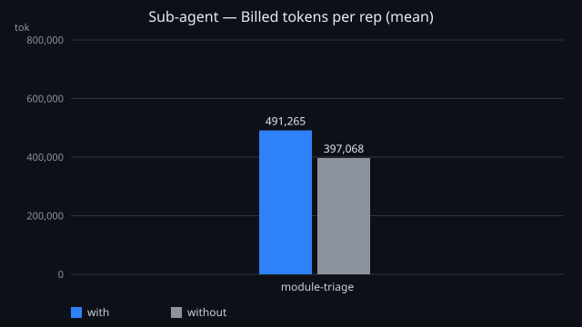
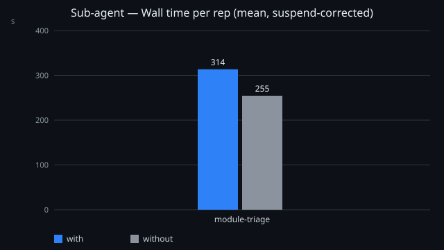

# Handoff Plugin Benchmark Report

A/B benchmark of the OpenCode harness with vs. without
`opencode-forward-handoff` (backend `gufo`, hard prompt cap ~32k, handoff
limit 24000, 5 reps per task/arm, deterministic `check.sh` grading).
Methodology and caveats: [README.md](README.md). Section 1 runs the tasks
single-agent; Section 2 runs `module-triage` with 4 parallel sub-agents.

## Single-agent

| task | arm | reps | success | wall (s) | billed tokens | hops | nudges | rejects |
|---|---|---:|---:|---:|---:|---:|---:|---:|
| pricing-engine | with | 5 | 100% | 213.5 | 247,455 | 1.0 | 0.2 | 0.0 |
| pricing-engine | without | 5 | 100% | 331.5 | 458,928 | 0.0 | 0.0 | 0.0 |
|  | **Δ (with vs without)** | | +0% | -36% | -46% | | | — |
| warehouse-cli | with | 5 | 100% | 39.3 | 62,248 | 0.0 | 0.0 | 0.0 |
| warehouse-cli | without | 5 | 100% | 42.6 | 78,385 | 0.0 | 0.0 | 0.0 |
|  | **Δ (with vs without)** | | +0% | -8% | -21% | | | — |

```
Billed tokens per rep (mean) — tok
pricing-engine with        ███████████████············· 247,454.6
pricing-engine without     ████████████████████████████ 458,928.2
warehouse-cli with         ████························ 62,248.4
warehouse-cli without      █████······················· 78,385.2
```

```
Wall time per rep (mean, suspend-corrected) — s
pricing-engine with        ██████████████████·········· 213.5
pricing-engine without     ████████████████████████████ 331.5
warehouse-cli with         ███························· 39.3
warehouse-cli without      ████························ 42.6
```


## Sub-agent

| task | arm | reps | success | wall (s) | billed tokens | hops | nudges | rejects |
|---|---|---:|---:|---:|---:|---:|---:|---:|
| module-triage | with | 5 | 100% | 313.5 | 491,265 | 0.2 | 0.0 | 0.0 |
| module-triage | without | 5 | 100% | 254.5 | 397,068 | 0.0 | 0.0 | 0.0 |
|  | **Δ (with vs without)** | | +0% | +23% | +24% | | | — |

```
Billed tokens per rep (mean) — tok
module-triage with         ████████████████████████████ 491,264.6
module-triage without      ███████████████████████····· 397,067.8
```

```
Wall time per rep (mean, suspend-corrected) — s
module-triage with         ████████████████████████████ 313.5
module-triage without      ███████████████████████····· 254.5
```

| task | arm | sub-agents | parent tok | sub-agent tok | parent peak | sub peak |
|---|---|---:|---:|---:|---:|---:|
| module-triage | with | 4.0 | 225,738 | 265,527 | 19,666 | 13,091 |
| module-triage | without | 4.0 | 155,401 | 241,667 | 17,393 | 12,605 |




## Summary

| scenario | verdict |
|---|---|
| Single agent, long task (pricing-engine) | **plugin wins**: −46% billed tokens, −36% wall, 0 provider rejects at 1 handoff hop/rep |
| Single agent, short task (warehouse-cli) | plugin is a verified no-op (gate never fires; deltas are noise) |
| 4 parallel sub-agents (module-triage) | **plugin does not help**: sub-agent sharding keeps every session 12–23k under the cap; the one rep that did hand off (parent peaked 26.5k) cost ~2× the arm mean |
