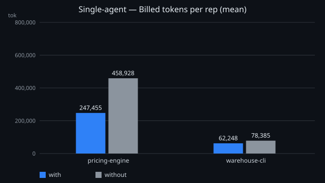
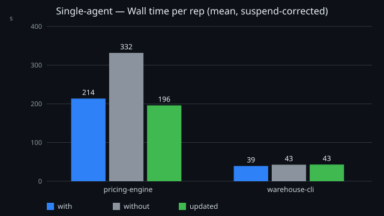
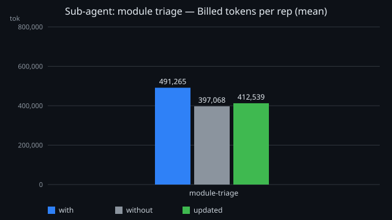
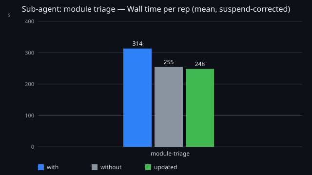
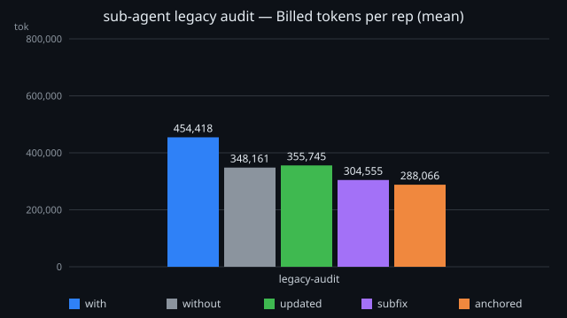
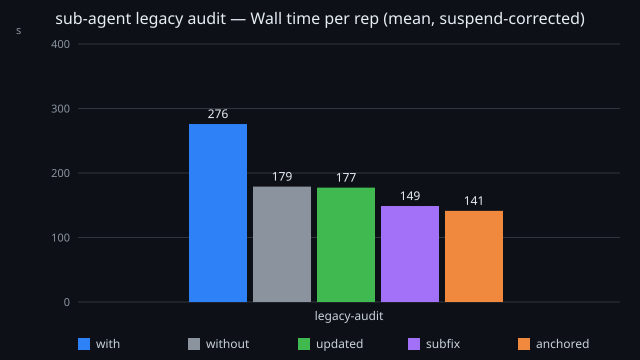

# Handoff Plugin Benchmark Report

A/B/A benchmark of the OpenCode harness with two versions of
`opencode-forward-handoff` vs. no plugin at all. Backend `gufo` (hard prompt
cap ≈32k tokens), handoff limit 24000 (subagent limit 16000 for the
sub-agent tasks, grace window 4000), 5 reps per task/arm, deterministic
`check.sh` grading. Methodology and caveats: [README.md](README.md).

**Arms** (plugin loads from GitHub, pinned per arm):

| arm | plugin | gate behavior |
|---|---|---|
| `without` | none | — |
| `with` | original (`7b12cd0`) | single threshold at 24000: tool call blocked, handoff forced immediately (fail-fast) |
| `updated` | grace window + deferral (`1057e49`) | warn-only band 24000–28000; at the hard gate, read-only calls at a safe boundary (no in-flight edit, empty/completed todos) are deferred up to 6× before forcing |
| `subfix` † | sub-agent fixes (`9e2ab69`) | retest arm: budget priming + relay schema on sub-agents, scoped 24k sublimit |
| `anchored` † | + relay anchor (`4bb5198`) | retest arm: relay replies must begin with the `TASK:` line |

† retest arms, run on the legacy-audit family only — see
[Sub-agent fixes retest](#sub-agent-fixes-retest-subfix-arm).

Task families: **Single-agent** (long `pricing-engine` build + short
`warehouse-cli`), **Sub-agent: module triage** (4 parallel sub-agents,
light shards), **Sub-agent: legacy audit** (4 parallel sub-agents over 4
sprawling legacy modules with locked specs and planted regressions).

## Single-agent

| task | arm | reps | success | wall (s) | billed tokens | hops | nudges | rejects |
|---|---|---:|---:|---:|---:|---:|---:|---:|
| pricing-engine | with | 5 | 100% | 213.5 | 247,455 | 1.0 | 0.2 | 0.0 |
| pricing-engine | without | 5 | 100% | 331.5 | 458,928 | 0.0 | 0.0 | 0.0 |
| pricing-engine | updated | 5 | 100% | 196.0 | 224,858 | 0.4 | 0.0 | 0.0 |
|  | **Δ (with vs without)** | | +0% | −36% | −46% | | | — |
|  | **Δ (updated vs without)** | | +0% | −41% | −51% | | | — |
|  | **Δ (updated vs with)** | | +0% | −8% | −9% | | | — |
| warehouse-cli | with | 5 | 100% | 39.3 | 62,248 | 0.0 | 0.0 | 0.0 |
| warehouse-cli | without | 5 | 100% | 42.6 | 78,385 | 0.0 | 0.0 | 0.0 |
| warehouse-cli | updated | 5 | 100% | 43.0 | 64,005 | 0.0 | 0.0 | 0.0 |
|  | **Δ (with vs without)** | | +0% | −8% | −21% | | | — |
|  | **Δ (updated vs without)** | | +0% | +1% | −18% | | | — |
|  | **Δ (updated vs with)** | | +0% | +9% | +3% | | | — |




```
Billed tokens per rep (mean) — tok
pricing-engine with        ███████████████············· 247,454.6
pricing-engine without     ████████████████████████████ 458,928.2
pricing-engine updated     ██████████████·············· 224,858.2
warehouse-cli with         ████························ 62,248.0
warehouse-cli without      █████······················· 78,385.2
warehouse-cli updated      ████························ 64,005.2
```

**pricing-engine** (multi-file build, contexts crash into the ≈32k backend
cap): the plugin's designed-for case. The `without` arm rambles at
29.4k-token peak occupancy and pays full-price re-sends — 459k tokens,
331 s. Both plugin arms cut billed tokens roughly in half
(−46% original, −51% updated). The updated gate edges out the original
(−8% wall, −9% tokens): the hard gate was crossed in 3 of 5 reps
(occupancy 28,727–30,678 ≥ hard 28,000) but only 2 needed a full
handoff+resume; the third drafted the artifact, then safe-boundary
deferrals let it finish in place (mean hops 1.0 → 0.4). The 9 grace-band
crossings were warn-only, never blocking. Pass rate is 100% everywhere.

**warehouse-cli** (short task, ~10.5k peak): never reaches the gate in any
arm. The −18%/−21% token deltas are within rep-to-rep variance
(±15%) — treat as noise, not plugin effect. The value shown here is that
the plugin is inert when it should be: zero gate events, no measurable
overhead.

## Sub-agent: module triage

Four parallel sub-agents triage small modules; parent integrates. Shards are
light — even the `with` arm's worst parent peak (26,480) barely touched the
24k gate, and no sub-agent came near 16k.

| task | arm | reps | success | wall (s) | billed tokens | hops | nudges | rejects |
|---|---|---:|---:|---:|---:|---:|---:|---:|
| module-triage | with | 5 | 100% | 313.5 | 491,265 | 0.2 | 0.0 | 0.0 |
| module-triage | without | 5 | 100% | 254.5 | 397,068 | 0.0 | 0.0 | 0.0 |
| module-triage | updated | 5 | 100% | 248.4 | 412,539 | 0.0 | 0.0 | 0.0 |
|  | **Δ (with vs without)** | | +0% | +23% | +24% | | | — |
|  | **Δ (updated vs without)** | | +0% | −2% | +4% | | | — |
|  | **Δ (updated vs with)** | | +0% | −21% | −16% | | | — |




| task | arm | sub-agents | parent tok | sub-agent tok | parent peak | sub peak |
|---|---|---:|---:|---:|---:|---:|
| module-triage | with | 4.0 | 225,738 | 265,527 | 19,666 | 13,091 |
| module-triage | without | 4.0 | 155,401 | 241,667 | 17,393 | 12,605 |
| module-triage | updated | 4.0 | 158,183 | 254,356 | 14,839 | 12,808 |

The original plugin's mean is dragged by **r4**: the parent crossed 24k
mid-integration, the fail-fast gate blocked a mutating call, and the
resulting handoff+resume burned ≈743k tokens (the single most expensive run
in the whole benchmark) for a task that was nearly done. The updated arm
showed no such rep (max 499k, hops 0), but note the sub-agent gate is
unchanged between plugin versions and no updated rep even approached the
gate — so the 24% → 4% gap vs `without` is mostly the removal of that one
pathology plus variance, not a measured steady-state win. The honest
summary: on tasks whose contexts never threaten the backend cap, the gate
should stay silent; every time it fires here it costs, and the updated
grace/deferral design shrinks (but does not eliminate) that exposure.

## Sub-agent: legacy audit

Four parallel sub-agents repair planted regressions in sprawling legacy
modules governed by locked spec docs (with a deliberately misleading
`docs/NOTES.md`). Shards run 13–24k tokens; the 16k subagent limit was
crossed in 2 of 15 runs. (Scope correction: that 16k gate sat *below* the
backend's real ≈32k capacity, so every crossing was a forced summary that
didn't need to happen — the `subfix`/`anchored` retests below re-ran this
family at the corrected 24k.)

| task | arm | reps | success | wall (s) | billed tokens | hops | nudges | rejects |
|---|---|---:|---:|---:|---:|---:|---:|---:|
| legacy-audit | with | 5 | 100% | 275.9 | 454,418 | 0.0 | 0.0 | 0.0 |
| legacy-audit | without | 5 | 100% | 178.9 | 348,161 | 0.0 | 0.0 | 0.0 |
| legacy-audit | updated | 5 | 100% | 177.3 | 355,745 | 0.0 | 0.0 | 0.0 |
| legacy-audit | subfix† | 5 | 100% | 148.8 | 304,555 | 0.0 | 0.0 | 0.0 |
| legacy-audit | anchored‡ | 5 | 100% | 141.3 | 288,066 | 0.0 | 0.0 | 0.0 |
|  | **Δ (with vs without)** | | +0% | +54% | +31% | | | — |
|  | **Δ (updated vs without)** | | +0% | −1% | +2% | | | — |
|  | **Δ (updated vs with)** | | +0% | −36% | −22% | | | — |
|  | **Δ (subfix vs without)** | | +0% | −17% | −13% | | | — |
|  | **Δ (subfix vs updated)** | | +0% | −16% | −14% | | | — |
|  | **Δ (subfix vs with)** | | +0% | −46% | −33% | | | — |
|  | **Δ (anchored vs without)** | | +0% | −21% | −17% | | | — |
|  | **Δ (anchored vs subfix)** | | +0% | −5% | −5% | | | — |

† `subfix` is the sub-agent retest arm (plugin @ `9e2ab69`, `--sublimit 24000`
instead of 16000) — see the retest subsection below.
‡ `anchored` adds the `TASK:`-line relay anchor (plugin @ `4bb5198`, same
limits) — see the anchor retest below.




| task | arm | sub-agents | parent tok | sub-agent tok | parent peak | sub peak |
|---|---|---:|---:|---:|---:|---:|
| legacy-audit | with | 4.0 | 132,122 | 322,297 | 14,042 | 17,165 |
| legacy-audit | without | 4.0 | 96,493 | 251,668 | 12,184 | 13,989 |
| legacy-audit | updated | 4.0 | 94,925 | 260,820 | 12,540 | 13,909 |
| legacy-audit | subfix† | 4.0 | 103,070 | 201,484 | 13,548 | 14,181 |
| legacy-audit | anchored‡ | 4.0 | 90,456 | 197,611 | 12,822 | 13,796 |

All 15 runs pass (60/60 `bun test` verified by `check.sh`), zero parent
handoffs — parents stay ≤16.7k. The action is in the sub-agents: the
`with` arm's gate fired twice (occupancy 16,192 and 19,609 ≥ 16,000), and
those are exactly its two most expensive reps (r2: 457 s / 641k tok;
r1: 318 s / 558k tok). The subagent fail-fast path forces a mid-shard
summary and the parent re-does the work — pure overhead when the true
backend cap is ≈32k. The updated arm's mean looks better (−36% wall vs
`with`), but its sub-agent gate is *identical* to the original's and simply
never fired (max sub peak 14,979 < 16k): that gap is sampling luck, not
the new grace/deferral logic, which only applies to primary sessions.
Family variance is huge (267k–641k tokens on identical prompts); with
n=5 these arm means are not statistically separated.

### Sub-agent fixes retest (`subfix` arm)

The gaps above pointed straight at the sub-agent path, so five fixes shipped
in `9e2ab69` and legacy-audit was re-run (n=5, `--limit 24000 --sublimit
24000`, results in `/tmp/opencode/bench/runs-la-sub`):

1. **Higher subagent limit** — the 16k default is far below this backend's
   real ≈32k capacity; the retest pins 24k.
2. **Grace band for sub-agents** (`subagentGraceTokens: 2000`) — warn-only
   band between soft and hard limit instead of a single cliff.
3. **Safe-boundary deferral for sub-agents** — at/over the hard limit, a
   read-only tool call with no in-flight mutation defers the forced summary
   to a safe boundary (same rules as primary sessions).
4. **Budget priming at the first prompt** — each sub-agent's first user
   prompt now carries a short `[handoff] Context budget:` primer that pins
   the relay contract up front, with no extra message.
5. **Relay-contract mini-schema** — TASK / CHANGED / CHECKS / FAILED / NEXT,
   ≤300 tokens, so sub-agent results (which stay permanently resident in the
   parent's re-sent context) are cheap. Sub-agents deliberately do **not**
   get real rollover: an orphaned child session's result would be lost.

| arm | success | wall (s) | billed | parent tok | sub tok | sub peak (max) | avg relay out tok |
|---|---:|---:|---:|---:|---:|---:|---:|
| with | 100% | 275.9 | 454,418 | 132,122 | 322,297 | 17,165 | 384 |
| without | 100% | 178.9 | 348,161 | 96,493 | 251,668 | 13,989 | 359 |
| updated | 100% | 177.3 | 355,745 | 94,925 | 260,820 | 13,909 | 340 |
| subfix | 100% | 148.8 | 304,555 | 103,070 | 201,484 | 14,181 | 230 |
| **anchored** | **100%** | **141.3** | **288,066** | **90,456** | **197,611** | 13,796 | **155** |

`subfix` beats every arm except its own follow-up: **−13% billed / −17% wall
vs `without`**, −14% / −16% vs `updated`, −33% / −46% vs `with` — the first
arm to beat the no-plugin baseline on this family. All 5 reps pass, zero hops,
zero forced summaries: max sub-agent occupancy is 14,181, under the new 24k
soft limit, so fixes 2–3 never had to fire. All 28 gate checks in the serve
log are `gate=pass` (22 sub-agent lines at band `soft=24000 hard=26000`,
6 parent lines at `soft=24000 hard=28000`).

What is left is the token-side win from fix 5: priming was verified in the
run DB — all 20 scored sub-agent sessions carry the `[handoff] Context budget:`
primer on their first user prompt (20/20, `session_message` rows of type
`user`), and the average final relay shrank to **230 output tokens / 758
text bytes** (max 1,359 B) vs 340–384 tokens / 1,161–1,279 B in the baseline
arms (max 2,815 B). Since every relay token is re-billed as `cache.read` on
each subsequent parent turn, terse relays compound: the sub-agent share drops
to 201k billed (−20% vs `without`). Parent-side cost is flat-to-slightly-up
(103k vs 96k) — the primer itself plus normal variance — so the family win
comes from the children, as intended. (Caveat: same n=5 variance as above;
and the higher limit and the priming both contribute, though with no gate
events in either arm, the gate-raising itself adds no savings here — the
−13% vs `without` is priming/relay brevity.)

### Relay anchor retest (`anchored` arm)

The `subfix` relays were short but still led with bold prose before the
schema lines. The anchor (`4bb5198`) changes the contract: the relay reply
**must begin with the `TASK:` line** — one imperative sentence in both the
primer and the forced-summary prompt. Retest, same task/limits, 5 reps:

| metric | subfix | anchored | Δ |
|---|---:|---:|---:|
| billed tokens | 304,555 | **288,066** | −5% |
| wall (s) | 148.8 | **141.3** | −5% |
| parent tok | 103,070 | **90,456** | −12% |
| sub-agent tok | 201,484 | **197,611** | −2% |
| avg relay out tok | 230 | **155** | −33% |
| avg relay bytes | 758 | **524** | −31% |

Habit compliance, checked directly against each run DB (`session_message`
rows, final assistant message of every sub-agent session):

| arm | relays | start with `TASK:` | bold-prose offenders | max bytes |
|---|---:|---:|---:|---:|
| subfix | 20 | 13 (65%) | 3 | 1,359 |
| anchored | 20 | **20 (100%)** | **0** | 1,288 |

All 5 reps pass with zero hops and zero forced summaries — the anchor cost
nothing and the terse-relay compounding got the parent side down to 90k, now
*below* the `without` parent (96k). Both arms produced exactly 20 relays
(4 sub-agents x 5 reps), so the compliance and brevity comparison is
apples-to-apples. As
before, hard enforcement is impossible in V2 (`execute.after` only sees the
async kickoff stub; the relay lands as a harness-written synthetic message
with no rewrite hook), so prompt anchoring is the lever — and at 20/20
starts and 0/20 offenders it is sufficient here.

## Analysis

**Where the plugin wins.** Only the single-agent `pricing-engine` runs
sustainably threaten the ≈32k backend cap, and there the gate is a clear,
replicated win: −46% billed tokens and −36% wall (original), improving to
−51% / −41% with the grace window, at unchanged 100% success. The rollover
replaces full-price context re-sends with a ≤1.2k-token artifact.

**What the grace window changed.** Evidence from the updated arm's serve
log: 123 `gate=pass`, 9 `gate=grace` (warn-only, never blocked), 3
`gate=FIRE`. Of the 3 hard-gate crossings (28,727–30,678), 2 completed a
full handoff+resume and 1 (r1) was carried by safe-boundary deferrals to a
natural finish in place — mean hops 1.0 → 0.4 while keeping every pass.
The 743k-token mid-integration pathology from the original `with` arm did
not recur in any updated rep.

**Where the plugin doesn't help.** On sub-agent workloads whose shards
complete under the cap (module-triage fully, legacy-audit all but 2/15
sub-agents), every gate event is cost without benefit: forced summaries +
parent rework, +31%/+24% tokens in the `with` arms. That diagnosis drove
the sub-agent fixes retest above (`9e2ab69`: 24k subagent limit, grace
band, safe-boundary deferral, relay-contract priming) and the relay anchor
retest (`4bb5198`), which turned legacy-audit into the plugin's best family
result — −17% billed / −21% wall vs the no-plugin baseline, with the gate
never firing.

**Caveats.** n=5 per cell; rep-to-rep variance within a cell reaches
±40% (see legacy-audit), so small deltas (<±10%) between arms — e.g.
warehouse-cli, updated-vs-without module-triage — should be read as noise.
Success was 100% in all 70 scored runs (60 in the main sweep + the 2 legacy-
audit retests), so the benchmark measures efficiency, not
capability: the discriminating signal is token/wall cost on tasks that
actually approach the context cap. One systemic lesson: the original
legacy-audit sweep enforced a 16k subagent limit against a ≈32k backend, so
its "gate fires = cost" numbers were measuring self-inflicted handoffs; the
retests re-established the same conclusion at the correct scope.
